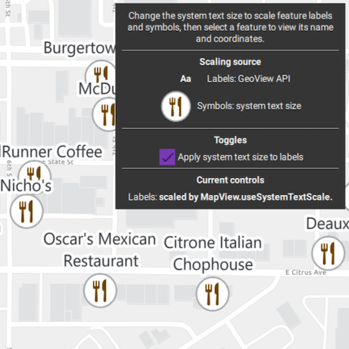

# Update labels and symbols to scale for visual accessibility

Scale feature labels and symbols according to the system text-size setting.

## Use case

Use this pattern to improve map readability for users who increase text size in their operating system’s accessibility settings. Enable `MapView.useSystemTextScale` to scale feature labels automatically.

## How to use the sample

Change the text size in the operating system's accessibility settings to see the restaurant labels and symbols resize. On iOS, open **Settings** > **Accessibility** > **Display & Text Size** > **Larger Text**. On Linux (GNOME), open **Settings** > **Accessibility** > **Seeing** > **Large Text**.

Clear **Apply system text size to labels** to stop labels from following the system text size, then select it again to restore system text scaling. Restaurant symbols continue to follow the system text size independently of this setting. The legend and current values show how labels and symbols are scaled.

Select a restaurant to show its name and WGS 84 coordinates in a callout. Select elsewhere to clear the callout.

## How it works

1. Create a `Map` and add a `FeatureLayer`.
2. Load the `restaurant` symbol from `Esri2DPointSymbolsStyle` and apply it with a `SimpleRenderer`.
3. Load the feature layer, then add a `LabelDefinition` with a `TextSymbol`.
4. To scale labels, enable `MapView.useSystemTextScale`.
5. To scale symbols, read `SystemTextScaleMonitor::textScale()` and connect to its `textScaleChanged` signal. This sample helper monitors the platform's system text-size setting. Set `MultilayerPointSymbol::setSize()` to the base symbol size multiplied by the system text-scale factor.
6. Use the checkbox to toggle system text scaling for labels without changing symbol scaling.
7. Identify a restaurant with `GeoView::identifyLayerAsync` and show its name and WGS 84 coordinates in a callout.

## Relevant API

- GeoView.useSystemTextScale

## About the data

This sample uses a [Redlands restaurants](https://www.arcgis.com/home/item.html?id=46119989eccd46a58b8f3d7aedadeb90) feature layer covering food establishments in Redlands, California. Each feature represents a single restaurant.

The restaurant symbol comes from [Esri's 2D point symbol web style](https://www.arcgis.com/home/item.html?id=220936cc6ed342c9937abd8f180e7d1e).

## Additional information

`GeoView.useSystemTextScale` is supported on iOS, Android, Windows, and Linux (GNOME desktop environments only). It is not supported on macOS.

## Tags

accessibility, label, readability, scale, symbol, text, visual impairment
