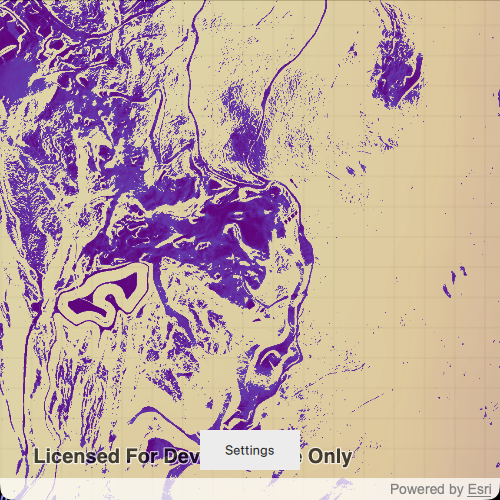

# Control map algebra inputs with float suppliers

Use float suppliers to dynamically update numeric inputs to a map algebra expression and refresh analysis results as the input values change.

## Use case

Adjust a slope range to explore terrain. The sample initially highlights slopes from 0 to 10 degrees over an elevation field. Change the minimum and maximum values from 0 to 85 degrees to update the displayed slope results.

## How to use the sample

When the sample opens, the map shows the result of a slope analysis which displays slopes between 0 to 10 degrees. This range shows gentle hills and flatter areas such as roads and man-made structures in dark purple. Select Settings and drag the range slider handles to adjust the minimum and maximum slope values between 0 and 85 degrees (the maximum slope value of the data). The analysis updates automatically to show only slopes within the selected range. An indicator in the settings panel shows when the analysis is updating. The slope results are drawn on top of an elevation field which is rendered with a surface color ramp to provide context for the data. Green areas represent lower lying terrain, and brown to white reflects higher elevations.

## How it works

1. Create a `ContinuousField` from an elevation raster file using `ContinuousField::createFromFilesAsync`.
2. Create a `ContinuousFieldFunction` from the continuous field using `ContinuousFieldSupplier`.
3. Derive a `slope` function from the continuous field function.
4. Create two `FloatSupplier` instances and set their `value` properties to the initial minimum and maximum slope values.
5. Create a `BooleanFieldFunction` for the slope range using the map algebra operations `isGreaterThanOrEqualTo`, `isLessThanOrEqualTo`, and `logicalAnd`, with the float suppliers as inputs.
6. Apply the boolean selection to the slope function using `mask` to retain only slopes within the selected range.
7. Create a `FieldAnalysis` for the masked slope function using `ContinuousFieldFunction` and a `StretchRenderer`.
8. Add the field analysis to an `AnalysisOverlay` and add the overlay to the map view.
9. Update the float suppliers' `value` properties to update the analysis result dynamically.

## Relevant API

* AnalysisOverlay
* BooleanFieldFunction
* ColorRamp
* ContinuousField
* ContinuousFieldFunction
* ContinuousFieldSupplier
* FieldAnalysis
* FloatSupplier
* StretchRenderer

## About the data

The sample uses a [1m resolution digital terrain elevation raster of the area over Méribel](https://www.arcgis.com/home/item.html?id=e8fe90cd623b48dfa683f448bef65e70), in the French Alps. The spatial reference of the data is UTM32N. 

## Tags

elevation, field analysis, float supplier, map algebra, raster, slope, terrain