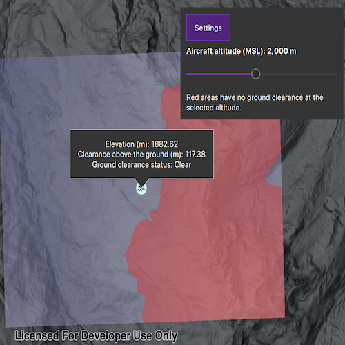

# Get field function value from a point

Sample field function values at a given position from a field analysis.

## Use case

In flight planning, elevation and ground clearance at a location help identify potential hazards as the planned aircraft altitude changes.

## How to use the sample

The sample opens displaying both an elevation field (purple-gray tones) and a boolean field that shows where an aircraft flying with an altitude of 2000m above sea level would not have ground clearance (red). The ground clearance field is determined by subtracting the elevation field from an altitude value. A callout in the centre of the data displays the values of each field, which have been sampled from the callout's position. Tap, or tap and drag the map to sample the values of each field across the data extent from the tapped position. Open the settings tab to adjust the altitude value and see the ground clearance's spatial extent update across the map. The tapped position's sampled value of the ground clearance boolean field will update automatically.

Red areas indicate terrain that would have no ground clearance given the set altitude value.

## How it works

1. Create a `Map` with the `ArcGISHillshadeDark` basemap style and display it in a `MapQuickView`.
2. Add a `GraphicsOverlay` to the map view for the selected point, and an `AnalysisOverlay` to display the field analyses.
3. Load the elevation raster into a `ContinuousField` with `ContinuousField::createFromFilesAsync()`.
4. Create a `ContinuousFieldSupplier` from the continuous field to provide the elevation function, and a `FloatSupplier` to hold the aircraft altitude.
5. Create a `BooleanFieldFunction` by calling `ContinuousFieldSupplier::isLessThan()` with the altitude supplier. The function is true where the terrain elevation is below the aircraft altitude.
6. Create `ContinuousFieldSampleFunction` and `BooleanFieldSampleFunction` objects from their corresponding field functions.
7. Create a `FieldAnalysis` for each field function and add them to the `AnalysisOverlay`. Use `MinMaxStretchParameters`, `ColorRamp`, and `StretchRenderer` to render elevation, and `Colormap` and `ColormapRenderer` to render the boolean result.
8. Convert the selected screen position to a map location with `MapQuickView::screenToLocation()`. Set that `Point` as the position of both sample functions and call `evaluateAsync()` to retrieve their values.
9. Display the sampled values and derived numeric ground clearance in the map view's `CalloutData`, shown by the Toolkit `Callout` in QML.
10. When the altitude changes, update the `FloatSupplier` with `setValue()` so the boolean analysis recalculates. The sample reevaluates both sample functions to refresh the callout at the selected point.

## Relevant API

* AnalysisOverlay
* BooleanFieldFunction
* BooleanFieldSampleFunction
* CalloutData
* Colormap
* ColormapRenderer
* ContinuousFieldFunction
* ContinuousFieldSampleFunction
* ContinuousFieldSupplier
* FieldAnalysis
* FloatSupplier
* MinMaxStretchParameters
* PictureMarkerSymbol
* StretchRenderer

## About the data

The sample uses a [1m resolution digital terrain elevation raster of the area over Méribel](https://www.arcgis.com/home/item.html?id=6bb0ad0e3bd5410fa52191184578f0b2), in the French Alps.

## Tags

analysis, boolean field function, continuous field function, elevation, field analysis, field sample function, raster
