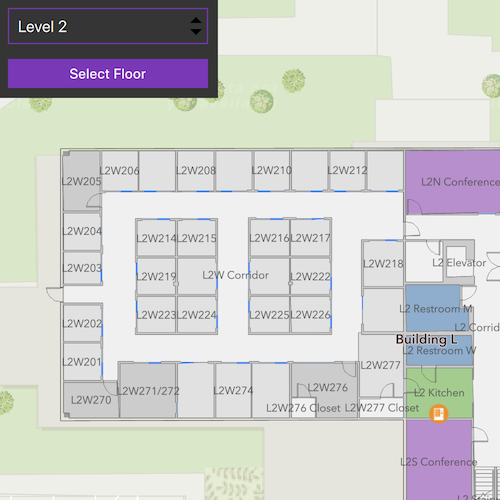

# Browse building floors

Display and browse through building floors from a floor-aware web map.

## Use case

Having map data to aid indoor navigation in buildings with multiple floors such as airports, museums, or offices can be incredibly useful. For example, you may wish to browse through all available floor maps for an office in order to find the location of an upcoming meeting in advance.

## How to use the sample

Use the FloorFilter control to select a site, facility, and floor. The map updates to display the selected floor.

## How it works

1. Create a `PortalItem` using the identifier of a floor-aware web map.
2. Create a map using the portal item.
3. Create a map view and assign the map to it.
4. Create a `FloorFilter` toolkit component and associate it with the `MapView`.
5. Use the component to browse sites, facilities, and floors in the map's `FloorManager`.

## Relevant API

* FloorFilter
* FloorManager

## About the data

This sample uses a [floor-aware web map](https://www.arcgis.com/home/item.html?id=f133a698536f44c8884ad81f80b6cfc7) that displays the floors of Building L on the Esri Redlands campus.

## Additional information

The `FloorFilter` component supports manual site and facility selection, as well as automatic selection based on the map's viewpoint.

This sample uses the `FloorFilter` component from the [ArcGIS Maps SDK for Qt toolkit](https://github.com/Esri/arcgis-maps-sdk-toolkit-qt), which must be cloned and set up locally to build the sample. For setup instructions, see the toolkit's [Qt Quick UI tools documentation](https://github.com/Esri/arcgis-maps-sdk-toolkit-qt/blob/main/uitools/toolkitcpp/README.md).

## Tags

building, facility, floor, floor-aware, floors, ground floor, indoor, level, site, story, toolkit
