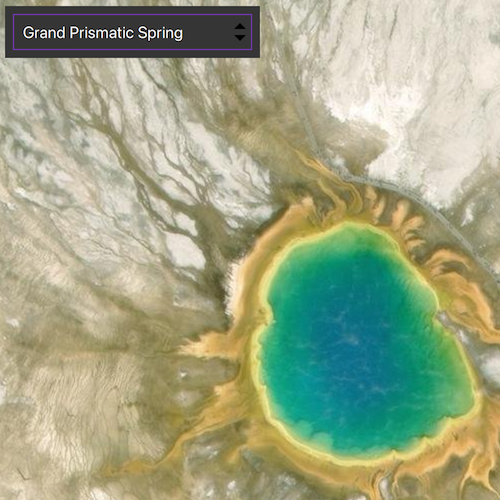

# Manage bookmarks

Access and create bookmarks on a map.

## Use case

Bookmarks are used for easily storing and accessing saved locations on the map. Bookmarks are of interest in educational apps (e.g. touring historical sites) or more specifically, for a land management company wishing to visually monitor flood levels over time at a particular location. These locations can be saved as bookmarks and revisited easily each time their basemap data has been updated (e.g. working with up to date satellite imagery to monitor water levels).

## How to use the sample

The map in the sample comes pre-populated with a set of bookmarks. Select a bookmark in the BookmarksView to move to that location. To add a bookmark, pan and/or zoom to a new location and click on the '+' in the bottom corner. Enter a name for the bookmark and click **Done**.

## How it works

1. Create a new `Map` object and get its `BookmarkListModel` with `Map::bookmarks()`.
2. Display the map's bookmarks in the toolkit's `BookmarksView`.
3. To create a new bookmark and add it to the bookmark list:
    * Create a new `Bookmark` object passing in text (the name of the bookmark) and a `Viewpoint` as parameters.
    * Add the new bookmark to the bookmark list with `BookmarkListModel::append(bookmark)`.

## Relevant API

* Bookmark
* BookmarkListModel
* BookmarksView
* Viewpoint

## Additional information

This sample uses the `BookmarksView` component from the [ArcGIS Maps SDK for Qt toolkit](https://github.com/Esri/arcgis-maps-sdk-toolkit-qt), which must be cloned and set up locally to build the sample. For setup instructions, see the toolkit's [Qt Quick UI tools documentation](https://github.com/Esri/arcgis-maps-sdk-toolkit-qt/blob/main/uitools/toolkitcpp/README.md).

## Tags

bookmark, extent, location, toolkit, zoom
